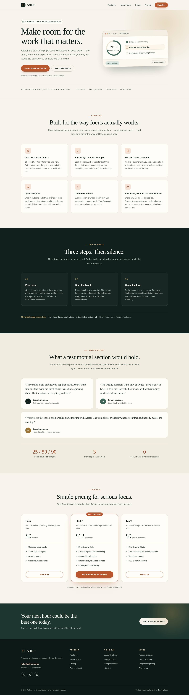
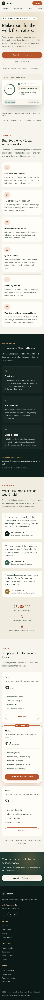

# Aether — Landing Page

This is task 1 of the OIBSIP Web Development and Designing internship: a product landing page built with HTML and CSS only. I made up a focus app called Aether and designed a page for it. The brand, the quotes and the pricing are all invented — it is a demo, not a real company.

There is no JavaScript anywhere on the page. The sticky header, the product mockup in the hero and every hover state are done with HTML and CSS.

## Checklist

| Official requirement | Status | Where it is |
|---|---|---|
| Sticky or fixed navigation with at least 3 links | ✅ | Sticky header with 4 links (Features, How it works, Demo, Pricing) and a CTA |
| Hero with headline, subheadline and CTA button | ✅ | `.hero` — "Make room for the work that matters." plus two buttons |
| At least two distinct content sections | ✅ | Features, How it works, Demo content and Pricing (4 sections) |
| Footer with contact and social placeholders | ✅ | `hello@aether.works` mailto link and 3 labelled social icons |
| Consistent colour palette | ✅ | One set of CSS variables: ivory, ink green, burnt orange, sage |
| Responsive layout with Flexbox and Grid | ✅ | Grid for sections and cards, Flexbox for nav, footer and buttons |
| Intentional spacing, `box-sizing`, no overlap | ✅ | Shared spacing scale; checked at 360, 768 and 1440px |
| Clean typography with at least two sizes | ✅ | Georgia headings (about 41–69px) and system sans body (16–18px) |
| HTML5 + CSS3 only, no JavaScript | ✅ | No `<script>` tags and no inline event handlers |
| Self-contained, no CDN or external fonts | ✅ | Two local SVGs; system font stacks only |
| No console errors | ✅ | Verified with Playwright at all three widths |

## How it is built

**Tech stack:** HTML5, CSS3 (custom properties, Grid, Flexbox) and inline SVG. No JavaScript, no framework and no dependencies.

- Semantic HTML5 landmarks: header, nav, main, section, article, footer.
- CSS custom properties for the palette, spacing and radii.
- Flexbox for one-dimensional rows, Grid for the feature, step, testimonial and pricing layouts.
- Inline SVG icons written by hand, plus `assets/logo-mark.svg` for the brand.
- Breakpoints at 1024px, 860px, 760px and 480px. Below 760px the nav wraps onto two rows so all links stay visible.
- Motion is limited to small hover lifts and a short fade-up in the hero. It is disabled under `prefers-reduced-motion`.

The palette is a warm paper and ink combination: `#f7f4ed` background, `#10201c` text, `#b7562c` accent and `#3e6659` for small success details. Headings use Georgia so the page feels a little like a printed page; everything else uses the system sans-serif.

## Files

```
WebDev-L1-LandingPage/
├── index.html
├── css/
│   └── styles.css
├── assets/
│   ├── favicon.svg
│   └── logo-mark.svg
├── screenshots/
│   ├── desktop.png
│   └── mobile.png
├── README.md
└── demo-notes.md
```

## Running it

```bash
cd WebDev-L1-LandingPage
python3 -m http.server 8000
```

Then open <http://localhost:8000> in a browser. Any static file server works; no build step or install is needed.

## Screenshots

Desktop, full page at 1440px wide:



Mobile, full page at 390px wide:



## One thing I would improve

The product mockup in the hero is made entirely of divs and CSS. It looks convincing, but if this were a real launch I would swap it for a screenshot of the actual app. I would also add a proper mobile menu instead of letting the links wrap, although the wrap keeps every link on screen without JavaScript.

## Demo video

[Watch the walkthrough](demo/demo.mp4). A short recording of the page: the sticky header, the nav links and a scroll through each section.

## Author

**Sushant Poudel** — Web Development & Designing intern, Oasis Infobyte SIP.
