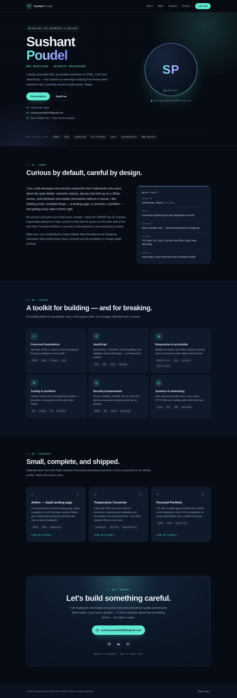
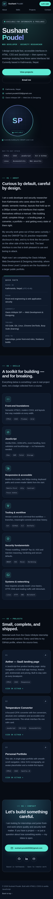

# Sushant Poudel — Personal Portfolio

Live demo: <https://sushant-me.github.io/OIBSIP/WebDev-L1-Portfolio/>

A one-page portfolio for Sushant Poudel, a web developer and security researcher based in Kathmandu. I built it as Level 1 task 2 of the Oasis Infobyte internship. The layout is a dark, full-width page with a single card-style contact block at the end.

The name, role and contact details are real. The avatar is an initials placeholder while there is no photo, and the LinkedIn URL is a placeholder that should be replaced before this goes anywhere public. The three project cards link to my GitHub profile rather than to individual repositories.

## The page, section by section

- **Hero** — name, role line, a short intro, two buttons and an SP avatar placeholder with an "Available" badge. A stack strip sits underneath.
- **About** — three short paragraphs and a "quick facts" panel with location, focus, current work, tools and what I am open to.
- **Skills** — six cards covering front-end basics, JavaScript, responsive and accessible layout, Git/tooling, security fundamentals and Linux/networking. The tags are the specific things I use, not levels or percentages.
- **Projects** — three cards: the Aether landing page, the temperature converter and this portfolio. Every card opens `https://github.com/sushant-me` in a new tab.
- **Contact** — a large email button and three inline SVG icons for GitHub, LinkedIn and email.

## Checklist

| Official requirement | Status | Notes |
|---|---|---|
| Hero with name, role title and avatar placeholder | ✅ | "Sushant Poudel / Web Developer · Security Researcher", CSS monogram avatar |
| About Me in 2–3 sentences | ✅ | Three short paragraphs plus a quick-facts list |
| Skills grid | ✅ | Six cards in a responsive Grid |
| At least 2 project cards with GitHub link placeholders | ✅ | Three cards, all linking to `github.com/sushant-me` |
| Contact with email and GitHub/LinkedIn icons (inline SVG) | ✅ | `mailto:` button and hand-written SVG icons |
| Smooth-scroll navigation | ✅ | Four anchor links; CSS `scroll-behavior: smooth` |
| Consistent branding | ✅ | SP monogram, teal/indigo palette, monospace labels |
| Fully responsive | ✅ | Checked at 360, 768 and 1440px; no horizontal scroll |
| No CDN, external fonts or remote assets | ✅ | Local favicon and system font stacks only |
| No inline event handlers | ✅ | All listeners use `addEventListener` in `js/main.js` |
| No console errors | ✅ | Verified with Playwright at all three widths |

## Build notes

**Tech stack:** semantic HTML5, CSS3 (custom properties, Grid and Flexbox), roughly 40 lines of vanilla JavaScript, inline SVG icons and one local SVG favicon. No libraries and no build step.

The page is semantic HTML5 with CSS custom properties for colour, spacing and type. Layout is Grid for the page sections, skills and projects, and Flexbox inside cards and the header. Colour contrast was checked against the dark background: body text is `#9daec6` or lighter on `#070c14`, and the accent is `#5eead4`.

Smooth scrolling is CSS. The small script in `js/main.js` does two extras: it writes the current year into the footer and highlights the nav link for the section in view using an IntersectionObserver. With JavaScript off, the page still scrolls and reads fine — only the active link highlight is missing.

## Files

```
WebDev-L1-Portfolio/
├── index.html
├── css/
│   └── styles.css
├── js/
│   └── main.js
├── assets/
│   └── favicon.svg
├── screenshots/
│   ├── desktop.png
│   └── mobile.png
├── README.md
└── demo-notes.md
```

## Running it

```bash
cd WebDev-L1-Portfolio
python3 -m http.server 8000
```

Open <http://localhost:8000>. There is no build step.

## Screenshots

Desktop, full page at 1440px wide:



Mobile, full page at 390px wide:



## Before publishing

- Replace the LinkedIn placeholder with the real profile URL.
- Swap the CSS avatar for a photo when one is available, keeping the same `role="img"` and label.
- Point each project card at its own repository once the repos are public.

## Demo video

[Watch the walkthrough](demo/demo.mp4). Recording of the navigation, the project cards and the contact section.

## Author

**Sushant Poudel** — Web Development & Designing intern, Oasis Infobyte SIP.
