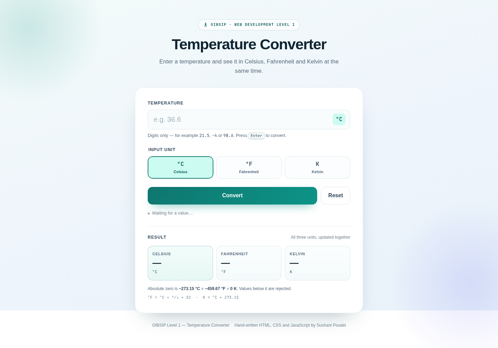
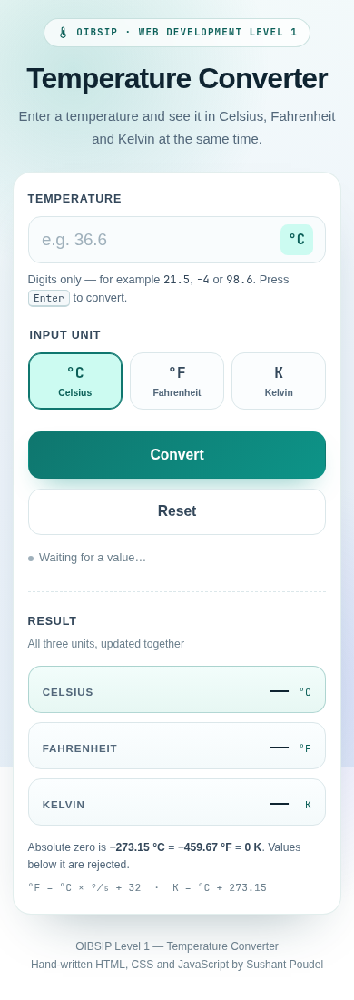

# Temperature Converter

A small converter for Celsius, Fahrenheit and Kelvin, built for Level 1 task 3 of the Oasis Infobyte internship. It is one centred card: type a temperature, pick the unit it is in, and all three units are shown together below. The page uses plain HTML, CSS and JavaScript with no libraries.

I used Celsius as the internal unit. Whatever is entered is converted to Celsius first, then back out to all three scales, which keeps the code short and stops the three results from drifting apart.

**Tech stack:** HTML5, CSS3 and vanilla JavaScript (one CSS file and one JS file). No libraries, no build step and no network requests.

## How the conversion works

- `°C = °F` conversion: `(F − 32) × 5 / 9`
- `°C = K` conversion: `K − 273.15`
- Output: `F = C × 9 / 5 + 32` and `K = C + 273.15`

Absolute zero is checked after converting the input to Celsius. Anything below `−273.15 °C` is rejected with a message that gives both the Celsius and Fahrenheit equivalents. The exact boundary is accepted, and a small epsilon handles floating-point noise so `−459.67 °F` is not rejected by accident.

Results are formatted with `Intl.NumberFormat` to at most two decimal places. Negative zero and floating-point dust such as `-0.0000000001` are normalised to `0`.

Non-numeric input is handled in two ways. The field is a `type="number"` input, so the browser blocks most letters by itself; when someone presses a letter anyway, a keydown listener shows a short hint explaining what is allowed. Submitting an empty field shows a friendly message instead of doing nothing.

## Checklist

| Official requirement | Status | Notes |
|---|---|---|
| Numeric input with validation and a friendly error for non-numeric values | ✅ | Number input, digit hint, empty and invalid messages |
| Input unit selector for C, F and K | ✅ | Accessible radio group styled as a segmented control |
| Output showing all three units at once | ✅ | Three result tiles update together |
| Convert button | ✅ | Submits the form and runs the same conversion as live typing |
| Result area with unit labels | ✅ | Celsius, Fahrenheit and Kelvin labels plus °C, °F, K |
| Absolute-zero violation message for values below −273.15 °C | ✅ | Error names all three scales and clears the results |
| Clean centred UI with clear labels | ✅ | Single card, labelled fields, formula and absolute-zero note |
| Bonus: live conversion while typing | ✅ | Runs on every `input` event and when the unit changes |
| Bonus: Enter key support | ✅ | Enter submits the form; no extra key handler needed |
| Bonus: reset button | ✅ | Clears input, results, error, unit and status |
| Bonus: accessible error announcements | ✅ | Error container has `role="alert"`; status line is `role="status"` |
| Self-contained, no libraries or CDN | ✅ | Local favicon, system fonts, one CSS file and one JS file |
| No inline event handlers, no `eval()` | ✅ | All listeners attached with `addEventListener` |
| Responsive with no console errors | ✅ | Checked at 360, 768 and 1440px |

## Tested cases

| Input | Unit | Result shown |
|---|---|---|
| 100 | °C | 100 °C / 212 °F / 373.15 K |
| 32 | °F | 0 °C / 32 °F / 273.15 K |
| 0 | K | −273.15 °C / −459.67 °F / 0 K |
| −273.15 | °C | −273.15 °C / −459.67 °F / 0 K (boundary accepted) |
| −300 | °C | Error: below absolute zero, results cleared |
| abc | °C | Letters blocked; hint says only digits, a decimal point and a minus sign work |
| empty | °C | Error asking for a value, with an example |

## Files

```
WebDev-L1-TemperatureConverter/
├── index.html
├── css/
│   └── styles.css
├── js/
│   └── converter.js
├── assets/
│   └── favicon.svg
├── screenshots/
│   ├── desktop.png
│   └── mobile.png
├── README.md
└── demo-notes.md
```

## Running it

```bash
cd WebDev-L1-TemperatureConverter
python3 -m http.server 8000
```

Open <http://localhost:8000>.

## Screenshots

Desktop, full page at 1440px wide:



Mobile, full page at 390px wide:



## A note on the layout

The results sit in three tiles on wider screens. Below 620px they become full-width rows with the label on the left and the value on the right, because three narrow tiles made longer values hard to read. The first tile (Celsius) has a slightly stronger tint since Celsius is the internal unit.

## Demo video

[Watch the walkthrough](demo/demo.mp4). Recording of a few conversions, the absolute-zero error and the reset.

## Author

**Sushant Poudel** — Web Development & Designing intern, Oasis Infobyte SIP.
