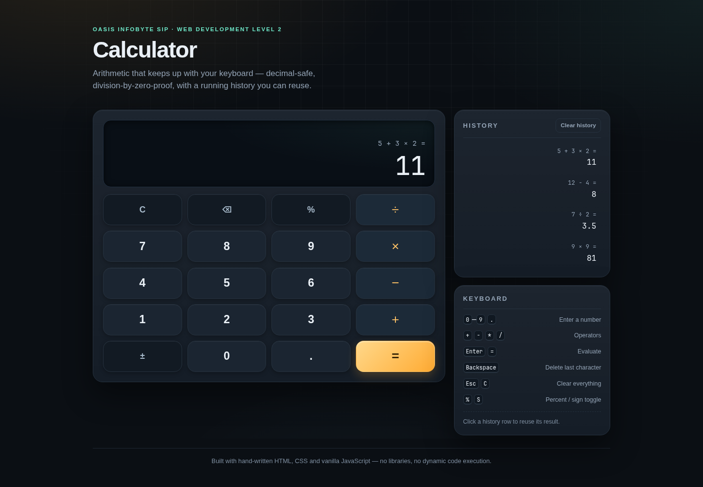
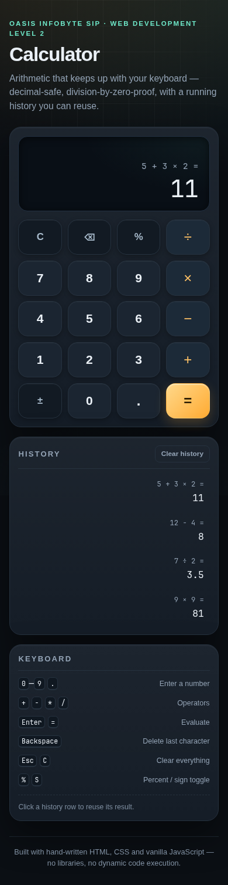
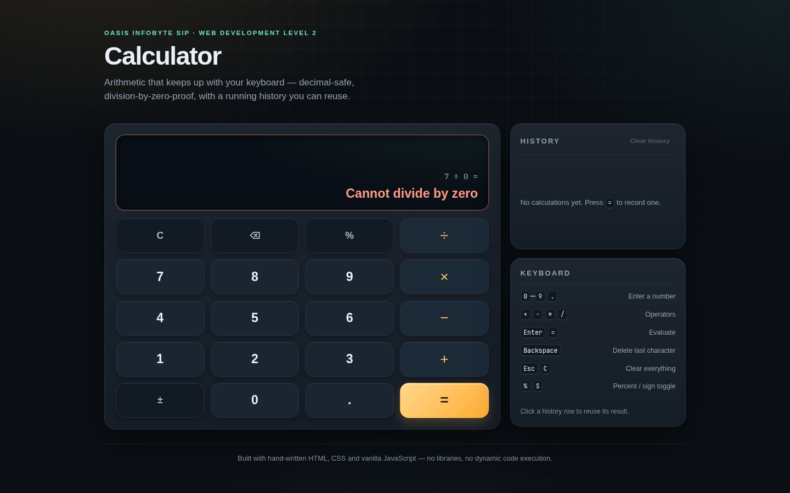

# Calculator

A working browser calculator built with plain HTML, CSS and JavaScript. It keeps the
expression on screen while you type, deals with the usual edge cases (a second decimal
point, repeated `=`, division by zero) and works from the keyboard as well as the mouse.

## What it does

The display has two lines. The small line shows the expression you are building and the
large line shows the value of the current entry, or the result after `=`. Operators chain
without needing a reset, so `5 + 3 × 2 =` gives `11` with normal mathematical precedence.
The history panel keeps the last 30 calculations; clicking one loads its result back into
the display so you can carry on from there.

## Checklist

| Official requirement | Status |
| --- | --- |
| Display shows current input and result | ✅ two-line display: expression above, value below |
| Digits 0–9 | ✅ |
| Decimal point | ✅ one decimal point per number |
| `+` `−` `×` `÷` operator buttons | ✅ |
| `=` evaluates | ✅ hand-written expression parser |
| `C` clears | ✅ |
| Backspace deletes the last character | ✅ also removes a pending operator |
| Division by zero shows an error, no crash | ✅ "Cannot divide by zero" |
| No `Infinity` / `NaN` leaks | ✅ checked in testing |
| Operator chaining without reset | ✅ `5 + 3 × 2` → `11` |
| CSS Grid button layout | ✅ four-column keypad |
| `addEventListener` on every button | ✅ listeners attached in `js/app.js` |
| No inline `onclick` | ✅ |
| No `eval()` | ✅ tokens are evaluated by two small passes |
| Bonus: keyboard input | ✅ digits, operators, Enter, Backspace, Esc, `%`, `S` |
| Bonus: sign toggle | ✅ `±` |
| Bonus: percent | ✅ divides the current entry by 100 |
| Bonus: calculation history | ✅ newest first, click to reuse |
| Robust: repeated equals | ✅ keeps re-applying the last operation |
| Robust: long numbers | ✅ thousands separators, then scientific notation |

## Behaviour notes

- Precedence follows normal maths, not left-to-right calculator order: `5 + 3 × 2 = 11`.
- Repeated `=`: `5 + 3 =` gives `8`, `=` again gives `11`, then `14`.
- Percent works on the entry you are typing: `200 × 5 % =` gives `10`.
- A single entry is capped at 15 digits so precision does not silently drift.
- Results larger than `Number.MAX_SAFE_INTEGER` (or smaller than `1e-6`) switch to
  scientific notation instead of printing a misleading long integer.
- History lives in memory only; a refresh clears it.

## Tech stack

HTML5, CSS3 (Grid and Flexbox), vanilla JavaScript. No framework, no build step, no
external fonts or CDN files. The favicon is a small local SVG.

## Files

```
WebDev-L2-Calculator/
├── index.html
├── css/
│   └── styles.css
├── js/
│   └── app.js
├── assets/
│   └── favicon.svg
├── screenshots/
│   ├── desktop.png
│   ├── mobile.png
│   └── division-by-zero.png
├── README.md
└── demo-notes.md
```

## Running it

```bash
cd WebDev-L2-Calculator
python3 -m http.server 8000
```

Then open <http://localhost:8000>. Opening `index.html` directly from disk also works,
since there is no data fetching involved.

## Screenshots

Desktop, full page at 1440 px wide:



Mobile, full page at 390 px wide:



The division-by-zero state:



## Testing

I drove the finished page with Playwright and Brave at 360×640, 768×1024 and 1440×900.
The script clicks the real buttons, reads the display text and checks 60 points in total:
the arithmetic flows above, decimal restrictions, repeated equals, history, keyboard
input, no horizontal scroll at any of the three widths and no console errors. All 60
passed.

## Demo video

[Watch the walkthrough](demo/demo.mp4). Recording of the main flows: operator chaining, division by zero, decimals, keyboard input and history.

## Author

Sushant Poudel — Web Development & Designing intern, Oasis Infobyte SIP.
