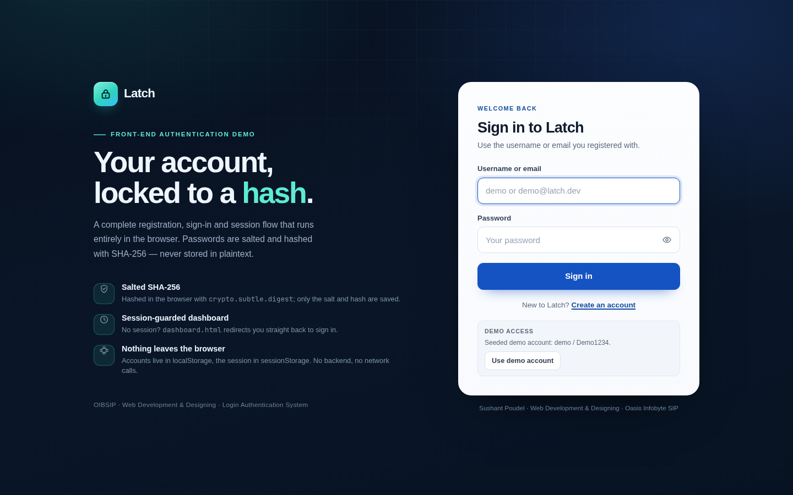
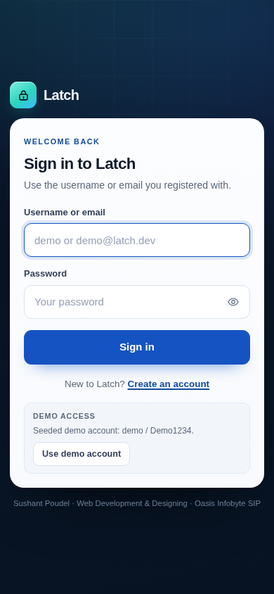
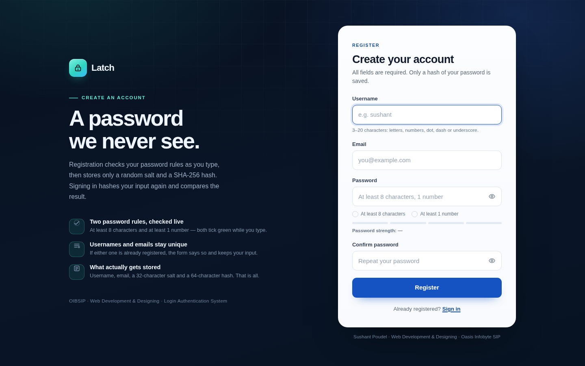
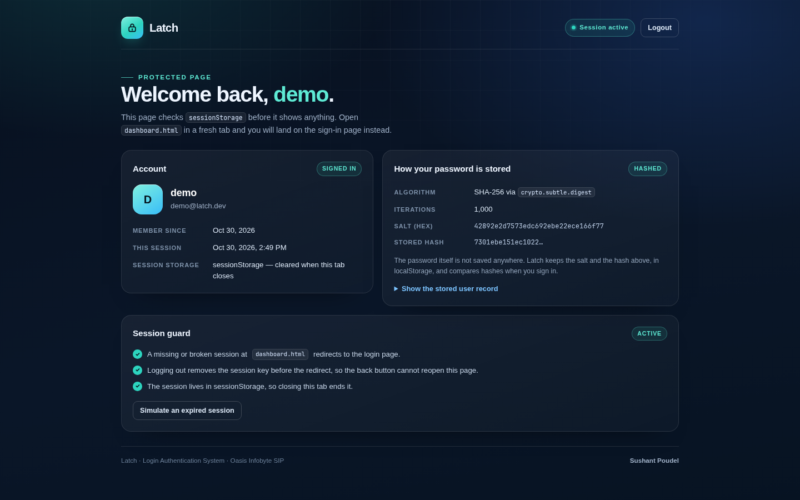

# Latch — Login Authentication System

Live demo: <https://sushant-me.github.io/OIBSIP/WebDev-L2-LoginAuth/>

Latch is the Login Authentication System task from the OIBSIP Web Development & Designing
(Level 2) track, built with approach A: front end only, no server. It has a registration
page, a sign-in page and a dashboard that refuses to load without a session. Accounts are
kept in localStorage; the session is kept in sessionStorage.

The important part is that passwords are never saved as text. Registration generates a
random salt, hashes the password with SHA-256 through `crypto.subtle.digest`, and stores
only the salt and the hash. Signing in does the same hash again and compares the result.



## The hashing scheme

1. Generate 16 random bytes with `crypto.getRandomValues` and store them as 32 hex characters.
2. Compute `h0 = SHA-256(saltBytes || utf8(password))`.
3. Repeat 999 times: `h = SHA-256(saltBytes || h)`. That makes 1,000 rounds in total.
4. Save `hex(h999)` and the salt in the user record.

A record in `localStorage` (`latch.users.v1`) looks like this:

```json
{
  "username": "demo",
  "usernameKey": "demo",
  "email": "demo@latch.dev",
  "emailKey": "demo@latch.dev",
  "salt": "1f0c…32 hex characters…",
  "hash": "9b7e…64 hex characters…",
  "iterations": 1000,
  "createdAt": 1761800000000
}
```

Keeping a lowercased copy of the username and email makes duplicate checks and sign-in
case-insensitive. The recorded iterations are used again at sign-in, so old accounts would
still work if the number is raised later. When the username does not exist, the code still
runs one hash so a missing account does not answer noticeably faster than a wrong password.

### This is demo authentication, not production authentication

I want to be clear about the limits of a front-end-only login:

- Anyone with DevTools can read, edit or delete localStorage and sessionStorage. The
  dashboard guard stops an honest user from opening the page, nothing more.
- SHA-256 with 1,000 rounds is much weaker than Argon2id or bcrypt with a proper work factor.
  A real system would hash on the server, with rate limiting and secure cookies.
- There is no email verification, no password reset, no account lockout and no CSRF/session
  hardening, because there is no server to do them.
- The demo account is seeded on purpose so the page can be tried immediately, so its
  password is shown on the sign-in page. Never do that with real credentials.

The browser must also be in a secure context for `crypto.subtle` to exist. `http://localhost`
and `http://127.0.0.1` count as secure. Some browsers also treat `file://` as a secure
context, but serving through a local server is the reliable choice and keeps localStorage
on one origin. The pages check `isSecureContext` and show a warning if hashing is not
available. If you host the folder elsewhere, use HTTPS.

## Demo account and test flow

The first time the app loads in a browser it creates one demo account:

- username: `demo`
- email: `demo@latch.dev`
- password: `Demo1234`

You can press **Use demo account** on the sign-in page to fill those in, or register your
own account. To check the protected route, sign in, then paste `dashboard.html` into a new
tab — the dashboard redirects to the sign-in page because the session lives in that tab's
sessionStorage. Logout removes the session key before redirecting.

## Checklist

| Requirement | Done |
| --- | :---: |
| Registration page with username, email, password and a Register button | ✅ |
| Password rule: at least 8 characters and at least 1 number, with inline feedback | ✅ |
| Duplicate username or email rejected with an error | ✅ |
| Login page | ✅ |
| Wrong credentials show one generic error (never says which field) | ✅ |
| Dashboard redirects to login when there is no session, including direct URL access | ✅ |
| Logout clears the session and returns to the login page | ✅ |
| Passwords salted and hashed with SHA-256 via `crypto.subtle.digest`, never stored as text | ✅ |
| Salt + hash scheme documented, with the secure-context / local-server note | ✅ |
| Empty-submission validation on both forms | ✅ |
| Password strength meter (extra) | ✅ |
| Show/hide password buttons (extra) | ✅ |
| Session stored in sessionStorage (extra) | ✅ |
| Demo account hint on the login page (extra) | ✅ |
| Separate login, register and dashboard pages | ✅ |
| No inline event handlers, no console errors | ✅ |
| Checked at 360×640, 768×1024 and 1440×900 | ✅ |

I checked the whole flow with a Playwright script (83 assertions): empty forms, weak
passwords, duplicate username/email, successful registration, wrong password and unknown
user producing the same error text, correct login, direct dashboard access without a
session, logout, the stored records containing no plaintext, and the three screen sizes.

## Built with

- HTML5, CSS3 and vanilla JavaScript, with no frameworks or build step.
- Web Crypto: `crypto.subtle.digest` for SHA-256 and `crypto.getRandomValues` for salts.
- localStorage for user records, sessionStorage for the signed-in session.
- No external fonts, libraries, CDN files or network requests.

## Pages and files

```
WebDev-L2-LoginAuth/
├── index.html            sign-in page
├── register.html         registration page
├── dashboard.html        protected page
├── css/
│   └── styles.css
├── js/
│   ├── auth.js           hashing, storage, sessions and small UI helpers
│   ├── login.js          sign-in form
│   ├── register.js       registration form, rules and strength meter
│   └── dashboard.js      session guard and dashboard rendering
├── assets/
│   └── favicon.svg
├── screenshots/
│   ├── desktop.png       sign-in, 1440×900
│   ├── mobile.png        sign-in, 390×844
│   ├── register.png      registration, 1440×900
│   └── dashboard.png     dashboard, 1440×900
├── README.md
└── demo-notes.md
```

## Running it

```bash
cd WebDev-L2-LoginAuth
python3 -m http.server 8000
```

Open <http://localhost:8000/>. Use the same host and port each run so the accounts and the
seeded demo user come from the same origin.

If you open the HTML directly from disk instead, hashing may or may not work depending on
the browser, and the browser keeps a separate localStorage store for file pages. The server
route is what I tested.

The UI uses a dark shell with a light form card, sans-serif headings and a small mono font
for the salt and hash. Local data can be cleared from DevTools → Application → Storage, or
by running `localStorage.removeItem('latch.users.v1')` in the console.

## Screenshots








## Demo video

[Watch the walkthrough](demo/demo.mp4). Recording of sign-in, the dashboard, logout, the protected-route redirect and registration. The demo account is demo / Demo1234.

## Author

**Sushant Poudel** — Web Development & Designing intern, **Oasis Infobyte SIP (OIBSIP)**.
