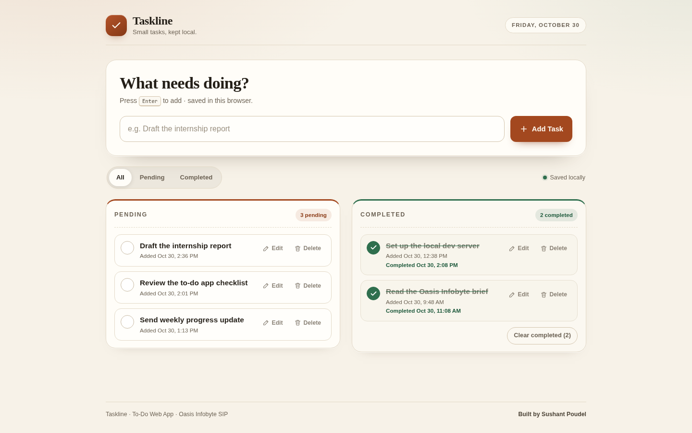
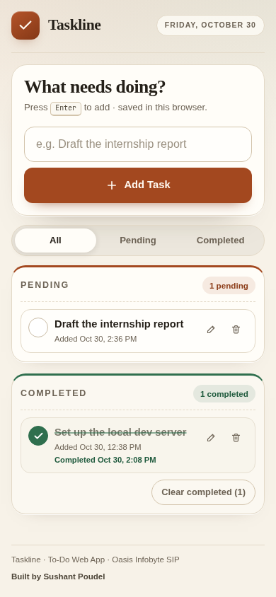

# Taskline — To-Do Web App

Live demo: <https://sushant-me.github.io/OIBSIP/WebDev-L2-TodoApp/>

Taskline is my submission for the To-Do Web App task in the OIBSIP Web Development &
Designing (Level 2) track. It is a single page where you can add tasks, move them between
Pending and Completed, edit a task in place, delete tasks, and come back later to find the
list unchanged. It is plain HTML, CSS and JavaScript — no frameworks, no build step, no
external files — and everything is saved in the browser's localStorage.



## Checklist

| Requirement | Done |
| --- | :---: |
| Input field and an **Add Task** button | ✅ |
| A new task appears in the Pending list immediately | ✅ |
| Mark Complete moves a task to Completed, and back again | ✅ |
| Inline editing | ✅ |
| Enter saves an edit, Escape cancels it | ✅ |
| Delete works from both Pending and Completed | ✅ |
| "X pending" counter above the Pending list | ✅ |
| "Y completed" counter above the Completed list | ✅ |
| Timestamp on each task ("Added …", "Completed …") | ✅ |
| Tasks persist after a page refresh using localStorage | ✅ |
| Friendly empty-state message for both lists | ✅ |
| Filter tabs: All / Pending / Completed (extra) | ✅ |
| Clear completed (extra) | ✅ |
| Undo after delete or clear (extra) | ✅ |
| Every action reachable from the keyboard (extra) | ✅ |
| No inline event handlers, no console errors | ✅ |
| Checked at 360×640, 768×1024 and 1440×900 | ✅ |

I tested the flows with a Playwright script (66 assertions): adding, completing and
un-completing, editing with Enter and Escape, deleting from both lists, undo, filters,
clear-completed, reload persistence, counters, timestamps, empty states, the three
screen sizes, and a check that no console errors or failed requests appear.

## Files

```
WebDev-L2-TodoApp/
├── index.html            page structure
├── css/
│   └── styles.css        all styling and the responsive layout
├── js/
│   └── app.js            task state, rendering, storage and keyboard handling
├── assets/
│   └── favicon.svg
├── screenshots/
│   ├── desktop.png       real capture, 1440×900 full page
│   └── mobile.png        real capture, 390×844 full page
├── README.md
└── demo-notes.md         click-by-click walkthrough
```

## Built with

- HTML5 for the page structure and form controls.
- CSS3 for the layout (Grid and Flexbox), custom properties, responsive breakpoints and focus styles.
- Vanilla JavaScript for state, rendering, localStorage and keyboard handling.
- Browser APIs: `localStorage`, `Intl.DateTimeFormat`, `crypto.randomUUID` (with a fallback).
- No libraries, no fonts, no CDN files and no build step.

## Running it

From inside this folder:

```bash
python3 -m http.server 8000
```

Then open <http://localhost:8000/>.

The page also opens from `file://`, but localStorage is tied to the origin. If you switch
between `file://`, `localhost` and `127.0.0.1`, each one starts with its own empty list.

## How the data is stored

Every change writes the whole task array to `localStorage` under the key
`taskline.tasks.v1`. Each task looks like this:

```json
{
  "id": "uuid",
  "text": "Draft the internship report",
  "createdAt": 1761800000000,
  "completed": false,
  "completedAt": null
}
```

Pending tasks are sorted newest first. Completed tasks are sorted by the time they were
completed. The timestamps are epoch milliseconds, formatted with `Intl.DateTimeFormat` when
the list is drawn.

Delete and clear-completed keep a one-step copy of the list so the toast can offer Undo.
There is no server and no sync, so clearing the site data removes the tasks for good.

## Screenshots

These two are captures of the built page in Brave, taken at the required sizes.




I used a warm paper-like palette and a serif heading for this project, with the two lists
side by side on desktop and stacked on small screens.

## Demo video

[Watch the walkthrough](demo/demo.mp4). Recording of adding, completing, editing and deleting tasks, then reloading to show the saved state.

## Author

**Sushant Poudel** — Web Development & Designing intern, **Oasis Infobyte SIP (OIBSIP)**.
