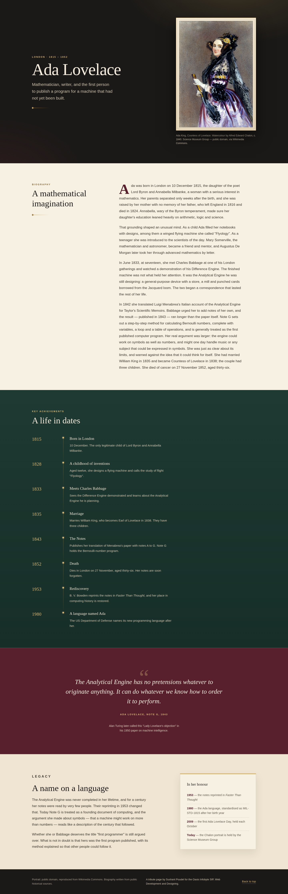
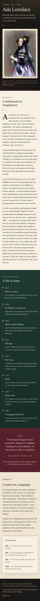

# Tribute Page — Ada Lovelace

Live demo: <https://sushant-me.github.io/OIBSIP/WebDev-L2-TributePage/>

A single static page about Ada Lovelace (1815–1852), written and laid out for the Oasis
Infobyte SIP Web Development track. It is HTML and CSS only — there is no JavaScript file,
because nothing on the page needs it.

## About the page

The page opens on a dark title panel with Ada Lovelace's name, a one-line tagline and a
framed copy of her 1840 watercolour portrait. Below that it moves through four sections:
a four-paragraph biography, a timeline of eight key dates, a full-width quote block with a
passage from her Notes, and a short legacy section with a small "in her honour" card. The
layout is intentionally traditional — serif headings, gold rules, a drop cap, parchment
and bottle-green backgrounds — rather than a modern app style.

## Official checklist

| # | Requirement | Where it is covered |
| --- | --- | --- |
| 1 | ✅ Page title with the subject's name and a one-line tagline | Hero: `Ada Lovelace`, then the line "Mathematician, writer, and the first person…" |
| 2 | ✅ Prominent image from a royalty-free source | `assets/ada-lovelace-portrait.jpg`, downloaded from Wikimedia Commons (public domain), shown in a framed mat |
| 3 | ✅ Portrait caption and credit | Caption under the portrait: artist, date, Science Museum Group, public domain, Wikimedia Commons |
| 4 | ✅ 3–4 original biography paragraphs | Four paragraphs under "A mathematical imagination" |
| 5 | ✅ Timeline / key achievements section | "A life in dates" — 1815, 1828, 1833, 1835, 1843, 1852, 1953, 1980 |
| 6 | ✅ Distinct styled quote block | Full-width deep-red band with the Note G passage and a citation |
| 7 | ✅ ≥2 different section background colours | Ink, parchment, bottle green, deep red, cream and ink again (6 in total) |
| 8 | ✅ ≥2 font styles | Serif headings (Georgia stack) and sans-serif body (system UI stack) |
| 9 | ✅ Responsive | Checked at 360×640, 768×1024 and 1440×900 with no horizontal scroll |

## Writing the biography

The four paragraphs are my own wording, put together from public historical sources rather
than copied from an article. The only direct quotation on the page is in the quote block:
two sentences from Note G of her 1843 Notes, which is the passage Alan Turing later called
"Lady Lovelace's objection". Nothing is made up and no quote is invented. Where the
"first programmer" title is contested, the page says so instead of overclaiming.

## Portrait and credit

- File: `assets/ada-lovelace-portrait.jpg` — 960 × 1379 px, 543 KB
- Subject: *Ada King, Countess of Lovelace*
- Artist: Alfred Edward Chalon, watercolour, c. 1840
- Source: Science Museum Group, via Wikimedia Commons
- Licence: public domain
- Downloaded with:
  `https://commons.wikimedia.org/wiki/Special:FilePath/Ada_Lovelace_portrait.jpg?width=800`
  using a normal browser user agent
- The image is stored in the project; the page does not hotlink to Wikimedia and makes no
  external requests at all

## Colours and type

| Colour | Hex | Used for |
| --- | --- | --- |
| Ink | `#1b1917` | Hero and footer |
| Parchment | `#f7f1e4` | Biography section |
| Bottle green | `#1e3a32` | Timeline section |
| Deep red | `#57202c` | Quote band |
| Cream | `#efe5d2` | Legacy section |
| Gold | `#c9a45a` | Rules, ornaments, years, citations |

Headings use a local serif stack (Georgia, Palatino, Times) and body copy uses the system
sans-serif stack. No webfonts are downloaded, so the page renders the same offline.

## Files

```
WebDev-L2-TributePage/
├── index.html
├── css/
│   └── styles.css
├── assets/
│   ├── ada-lovelace-portrait.jpg
│   └── favicon.svg
├── screenshots/
│   ├── desktop.png
│   └── mobile.png
├── README.md
└── demo-notes.md
```

## Running it

```bash
cd WebDev-L2-TributePage
python3 -m http.server 8000
```

Open <http://localhost:8000>, or open `index.html` directly — both work.

## Screenshots

Full page at 1440 px wide:



Full page at 390 px wide:



## Checks I ran

Playwright with Brave at 360, 768 and 1440 px. The script checked that the portrait
decodes from the local file, the caption contains the credit, the quote matches the
documented text exactly, there are at least two section background colours and two font
families, body text passes 4.5:1 contrast, no external request is made, there is no
horizontal scroll and the console stays clean. 46 checks passed.

## Demo video

[Watch the walkthrough](demo/demo.mp4). A scroll-through of the finished tribute page.

## Author

Sushant Poudel — Web Development & Designing intern, Oasis Infobyte SIP.
